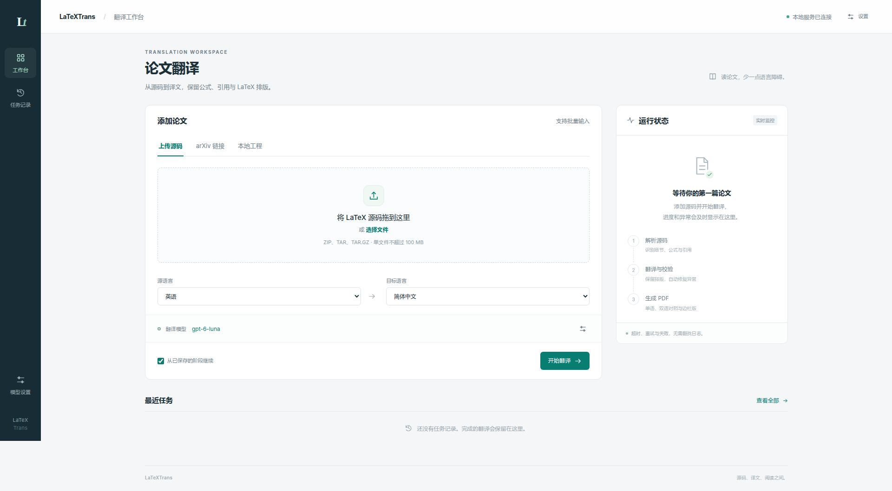
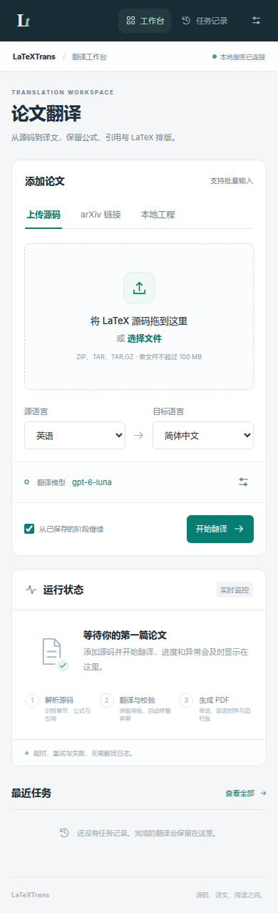

# 独立网页工作台

本次从零重写前端，默认入口不再使用 Streamlit。Python 标准库 HTTP 服务提供本地 API，
原生 HTML、CSS 和 JavaScript 提供界面，继续使用已有翻译子进程和事件监控。

视觉方向：深墨色窄导航、白色工作区、浅灰画布、青绿色主操作；异常使用语义红色。
变化 4/10，动效 1/10，密度 6/10。系统无衬线字体，代码使用等宽字体；
间距 4/8/12/16/24/32，圆角 8/12，边框 #e2e8ed，不使用装饰渐变。

结构：顶栏导航 → 主输入工作区 + 右侧实时运行台 → 输出文件与近期任务。
配置在原生 dialog 中编辑，任务历史独立页面。异常在运行台顶部持续可见。
上传、粘贴 arXiv、服务端本地路径都可启动真实翻译；界面不展示模拟任务。

交互：每秒轮询后台任务，显示请求等待与重试；停止真正结束子进程组；
浏览器刷新后恢复任务；PDF 与诊断文件直接下载。配置保存与接口测试均显式触发。
接口测试为最小生成请求，不能代表长文翻译的稳定性。

启动：`latextrans-gui` 或 `python -m src.gui.server`，默认 http://localhost:8501。
`LATEXTRANS_CONFIG` 可选择配置；`--host`、`--port` 可修改监听地址。

验证：125 项自动测试通过。`scripts/test_workbench_browser.py` 使用本地模拟接口验证
真实源码上传与翻译进程、首次限流提示、重试倒计时、刷新重连、停止、异常堆栈、
历史切换、PDF/诊断下载、连接中断恢复，以及连接和短文翻译两类测试。
该脚本不调用用户配置中的模型服务。已在 1920×950、1366×768、390×844 检查布局。

实际界面预览：

异步翻译、重译和界面测试读取 HTTP_PROXY / HTTPS_PROXY / NO_PROXY，与模型列表客户端保持一致。
是否实际经过 VPN 取决于系统路由和代理规则，界面中的连接成功不能用于判断 VPN 出口。

模型名称使用自定义可搜索下拉列表，点击默认显示完整列表，支持鼠标、键盘与手动填写。
高级设置的 PDF 保存目录支持系统目录选择器，取消不改变路径，保存设置后生效。
可多选单语、双语交替、左右并排三个版本，任务按启动时的设置复制最终 PDF。
保存目录留空时只保存在工作区；源码、缓存、映射 JSON 和编译文件始终留在工作区 `outputs`。
旧版的自定义输出路径作为 PDF 保存目录沿用，已有文件不会自动移动或删除。
复制失败或所选 PDF 未生成会进入任务异常记录，保留工作文件以便排错。
浏览器以 32 项模型列表验证桌面与手机上的展开、搜索、选择和路径选择/取消/保存流程。
Windows Forms 目录组件及交互式桌面能力已在当前 WSL 环境确认可用。
